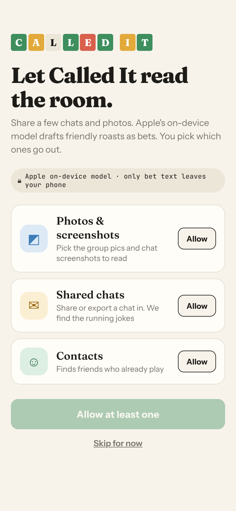
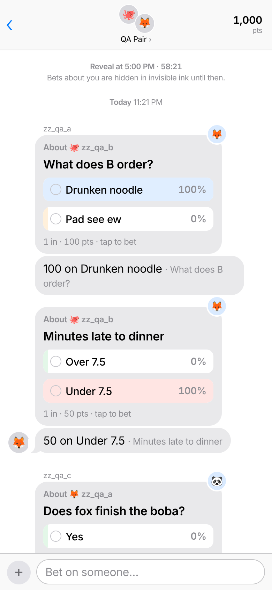
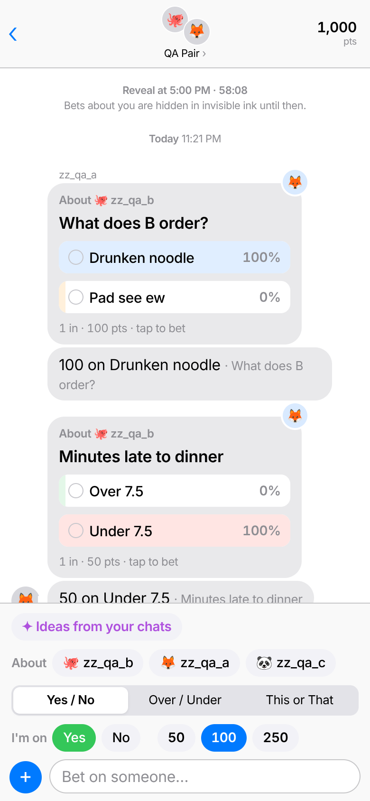
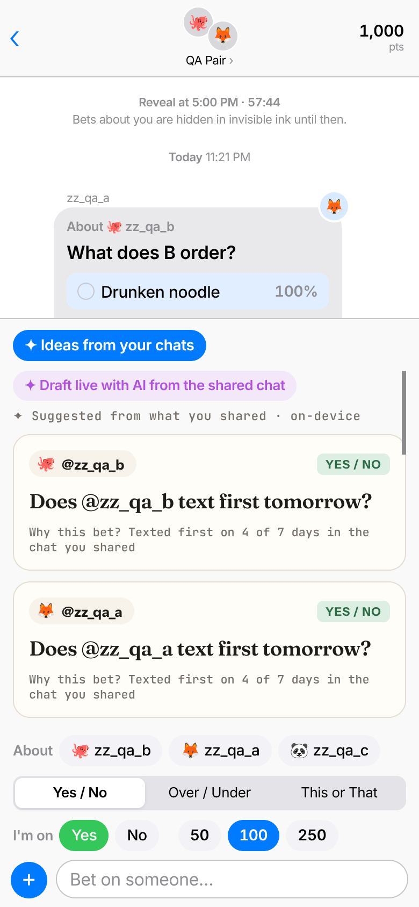
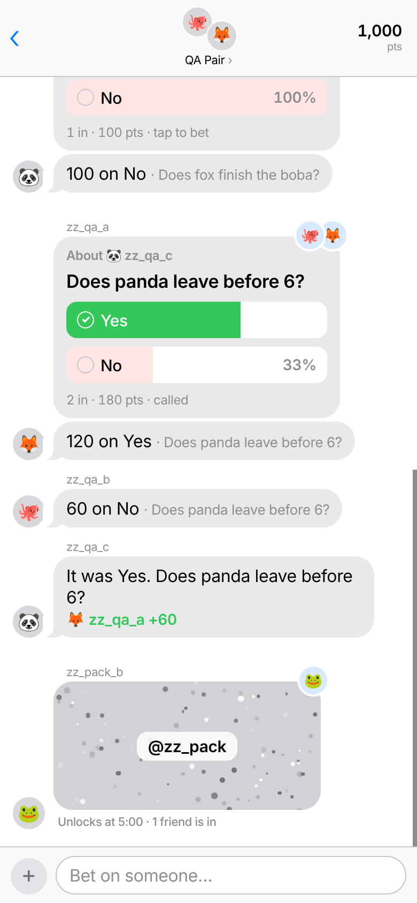
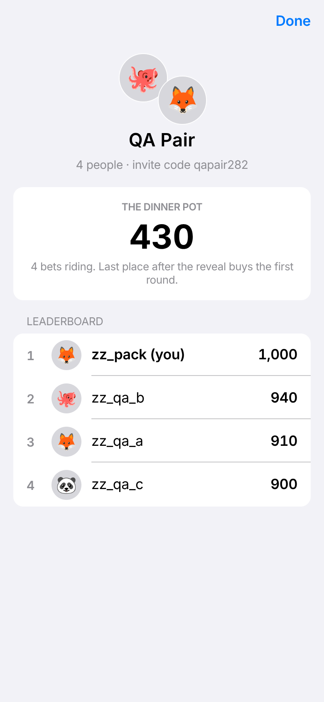

# Called It

A private betting game for your friend group that looks and feels like iMessage.

Your friends write bets about each other and send them as chat messages. Everyone stakes points, the odds move like a market, and the person a bet is about sees it only as invisible ink until the reveal. Then they rub it away and call what happened.

Live: https://reliable-kookabura-33.convex.site (the root is the new app)

The first version, a hackathon-wide game with hourly drops, a TV view and a host console, still runs at `/hackathon`.

## Screenshots

All taken at 390 by 844 on the live site, in a test group with test users (names start with zz_).

| Connect your context | Groups | Group chat |
| --- | --- | --- |
|  |  |  |

| Write a bet | Ideas from your chats | Invisible ink |
| --- | --- | --- |
|  |  |  |

| Group details |
| --- |
|  |

TODO (parent): add a screenshot of the rub-to-reveal and the honor-system call once the 5:00 PM reveal has run (or after a demo replay).

## How to play

1. Open the link or an invite link. Pick a username and one emoji. By joining you agree to friendly roasts from your crew. You can veto any bet about you at the reveal.
2. Optional: the "connect your context" screen. It is mocked today (see below).
3. The Groups screen shows your total points across groups, your best rank, and your nemesis, the friend who most often called it against you.
4. Open a group. It looks like a group chat. Each bet is a message from the friend who wrote it, or from "AI · Created by AI".
5. Write a bet in the compose bar: pick who it is about, pick a format, pick your side and a stake, and send. Formats are Yes/No, Over/Under (lines end in .5) and This or That.
6. Tap a bet to stake. Your stake posts to the chat as a message, and bettors show up as emoji reactions on the bet, like tapbacks.
7. If a bet is about you, you see it under invisible ink with only your name visible. You can see how many friends are in and how many points are riding on you, but not the question.
8. At 5:00 PM the reveal opens. Rub the ink to uncover the bet and everyone's positions. Then declare what happened. This is the honor system: the person it is about makes the call. Or veto it, and everyone is refunded.
9. Payouts post in the chat. Winners split the pot in proportion to their stakes, so the long shot pays the most.
10. Group details shows the leaderboard and the dinner pot. Last place buys the first round.

## Features

- iMessage-style group chat, with bets as messages and stakes as messages.
- Three formats: Yes/No, Over/Under with .5 lines, This or That.
- Pool-based live odds. Each side's price is its share of the pot, and it moves with every stake.
- Bettors shown as emoji tapback reactions on each bet.
- Invisible Ink for the person a bet is about, until the reveal.
- Rub-to-reveal, honor-system call, and veto with refunds.
- Groups list with total points, best rank and nemesis.
- Group details with leaderboard and a dinner pot.
- Bets from friends or from AI, labelled "AI · Created by AI".
- Mocked "connect your context" onboarding.
- Admin demo replay: reset the drop, replay the reveal on stage, and restore the real 5 PM results from a snapshot.

## Context and AI: what is real and what is staged

The real-world version works like this. You choose to share chat screenshots or exports and pick photos into the app. Apple's on-device model (Foundation Models, iPhone 15 Pro and newer) reads them on the phone and drafts bets. Only the bet text goes to Convex. The app does not read iMessage, SMS or calls.

What exists today:

- The "connect your context" screen and the suggestion cards ("Ideas from your chats") are staged. They show what the feature would suggest. They do not read anything from your phone.
- The "Draft live with AI from the shared chat" button calls a Convex action (`convex/ai.ts`, `suggest`) that sends a staged sample chat export to a hosted model (Anthropic). It shows the shape of the feature. It is not the on-device model.
- Nothing from a real chat, photo or contact is read or stored.

TODO (parent): confirm this section matches what you say on stage.

## Tech

- Expo (React Native and web) with Expo Router. One codebase for iPhone and web.
- Convex: realtime queries, mutations for staking, declaring and vetoing, an action for AI drafts, a cron, file storage.
- The web build is exported with Expo and published to Convex storage. An HTTP route serves it, so the live site is the Convex deployment itself.
- TypeScript throughout.

Layout: `src/app/c/` chat routes (groups list, thread, group details), `src/components/chat/` chat UI, `convex/chat.ts` chat backend, `convex/ai.ts` AI drafts, `src/app/hackathon.tsx` and the other `src/app/` files for the original game, `revyl/tests/` device tests.

## How we used Capy, Revyl and Convex

**Capy.** Capy coding agents wrote the app. A Captain thread planned the work and ran parallel threads and subagents on cloud machines, each opening its own pull request. Capy also ran the Revyl iOS builds and the cloud iPhone. This submission pack was written by a Capy subagent.

**Revyl.** We built the iOS app on Revyl's cloud runners and ran it on a cloud iPhone, with no local Xcode. Plain-English tests are in `revyl/tests/`.
- TODO (parent): link `revyl/results.md` and add the pass count for the new chat app. The current tests cover the original game.

**Convex.** Convex is the whole backend. The chat is a realtime query, so a stake on one phone moves the odds and the reactions on every other phone. Stakes, declares and vetoes are mutations, so pots, points and payout messages stay consistent. The AI draft is a Convex action that reads its key from an environment variable. The web app is served from Convex storage.

## Run locally

```bash
npm install
npx convex dev      # creates a dev deployment, writes .env.local, syncs convex/
npx expo start      # press w for web, i for iOS simulator, or scan with Expo Go
```

Set these in the Convex dashboard (Settings, Environment variables). Never commit them:

- `ADMIN_PASSCODE`: protects `/admin` and the demo replay.
- `ANTHROPIC_API_KEY`: for AI drafts. `AI_MODEL` overrides the default model.

Publish the web build to Convex storage (needs a deploy key in `CONVEX_DEPLOY_KEY`): `npm run publish:web`. Typecheck: `npm run typecheck`.
