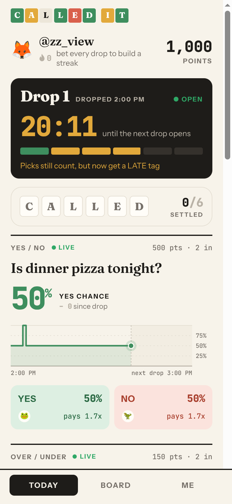
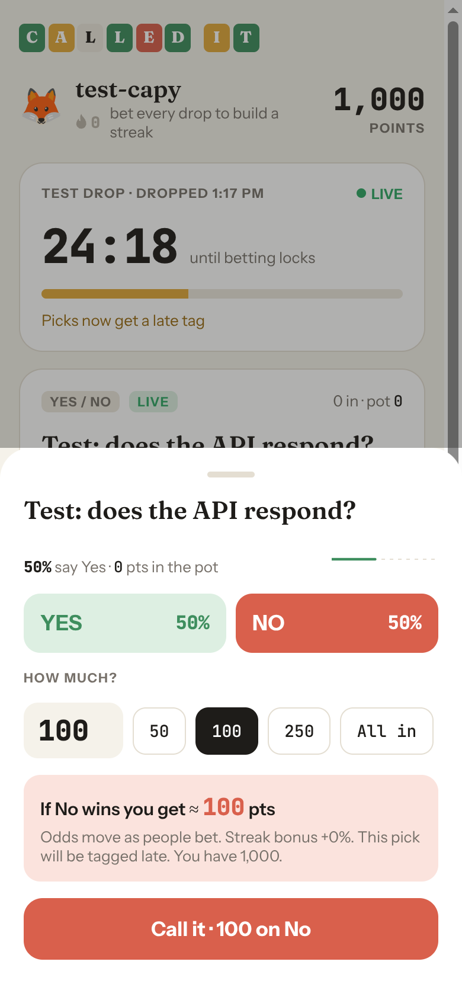
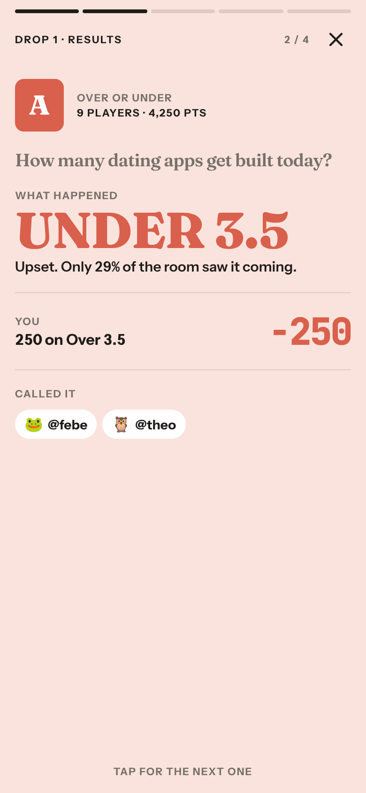
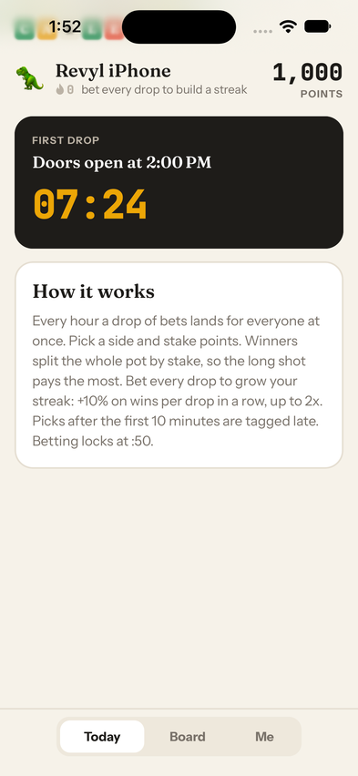
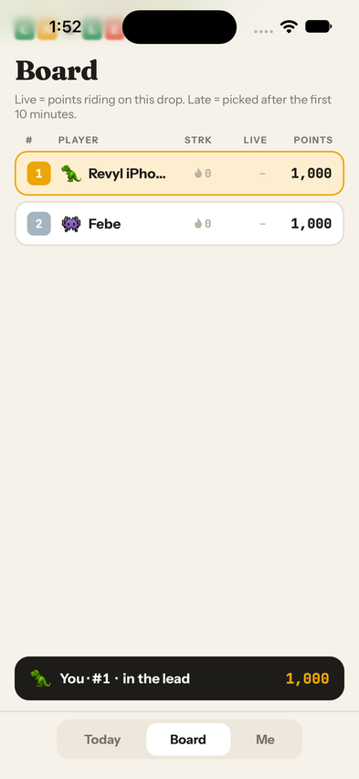
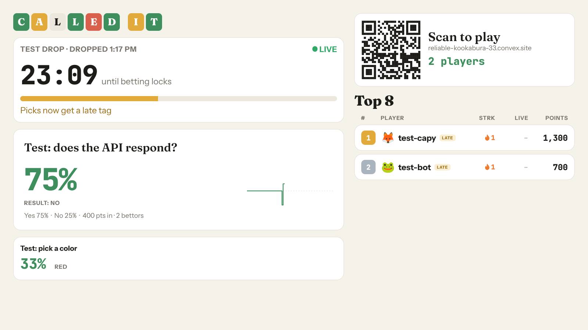

# Called It

A social prediction market for the people in the room. Bet points on what happens at the hackathon, tonight.

Every hour a new "Drop" of six bets lands. You pick a side, stake points, and watch the odds move like a real market. At the end, a story-style reveal shows who called it.

Live: https://reliable-kookabura-33.convex.site

## Screenshots

| Today | Stake sheet | Reveal |
| --- | --- | --- |
|  |  |  |

| iPhone: Today | iPhone: Board | /tv big screen |
| --- | --- | --- |
|  |  |  |

Some screenshots show test data (names like test-capy, zz_view).

## How to play

1. Open the live link, or scan the QR on the projector (`/qr`, or the top of `/tv`).
2. Pick a username and an emoji. You start with 1,000 points.
3. Every hour a Drop opens. Drop 1 is at 2 PM, Drop 5 at 6 PM is the finals. Each Drop has six bets, yes/no or over/under, about the room.
4. Tap a bet, pick a side, choose a stake (50, 100, 250, all in, or your own number). The sheet shows what you win if you are right.
5. Picks in the first 10 minutes are on time. After that they are tagged LATE. Betting locks at :50.
6. When the host settles a bet, winners split the whole pot in proportion to their stakes. The long shot pays the most.
7. Tap through the reveal to see each result. Tiles spell CALLED, one per bet: green won, red lost.
8. Bet every Drop to build a streak. Each consecutive Drop adds +10% to your winnings, up to 2x.

## Features

- Market odds. The price of each side is its share of the pot, shown as a percent with a price history chart. It moves with every stake.
- Hourly Drops, six bets each, with a countdown and an on-time window.
- Streak multiplier: +10% per consecutive Drop, capped at 2x.
- Leaderboard (`/board`) with points, streak, and points riding on the live Drop.
- Private groups (`/group/<id>`). Make a group, add friends, write your own bets, and the creator settles them. Bets can be about a person in the group (that person cannot see or bet on it).
- Story-style reveal of results with Wordle-style CALLED tiles, and a list of who called it.
- `/tv` big-screen mode: countdown, live odds, QR to join, top 8. Built for a projector.
- `/qr` join poster.
- Finals live counter. The host taps +1 each time someone says "agent" in a finalist demo. The bet is over/under 49.5 and settles from the count.
- Admin console (`/admin`, passcode protected): create Drops, add/edit/lock/delete bets, settle or refund, adjust the live counter.
- AI bet drafts in admin: paste a transcript or notes, a model drafts six bets, the host edits and approves them, and they are added to a Drop. Uses Anthropic or OpenAI, chosen by which API key is set as a Convex environment variable.
- Whop sandbox checkout (in progress): "loser buys the leader a coffee", plus an admin "pay the winner" action.
  - TODO (parent): update this line to say what actually shipped, or remove it.

## Tech

- Expo (React Native + web) with Expo Router. One codebase for iPhone and the web.
- Convex for the backend: realtime queries, mutations for staking and settling, an action for the AI drafts, a cron that prepares the next Drop, and file storage.
- The web build is exported with Expo and published into Convex storage. An HTTP route in `convex/hosting.ts` serves it, so the live site is the Convex deployment itself.
- TypeScript throughout.

Layout: `src/app/` routes, `src/components/` UI, `src/lib/` client helpers, `convex/` backend, `revyl/tests/` device tests, `scripts/publish-web.mjs` web publish.

## How we used Capy, Revyl and Convex

**Capy.** The app was written with Capy coding agents. A Captain thread planned the work and ran parallel threads and subagents, each on its own cloud machine and each opening its own pull request: the market and odds, the reveal story, groups, the TV view, admin and AI drafts. Capy also ran the Revyl iOS builds and opened the cloud iPhone. This submission pack was written by a Capy subagent.

**Revyl.** We built the iOS app on Revyl's cloud runners and ran it on a cloud iPhone, with no local Xcode. Plain-English tests live in `revyl/tests/`, and the run evidence is in `results.md`. The iPhone screenshots above come from that device.
- TODO (parent): add the pass count, for example "N of M tests pass", and link results.md.

**Convex.** Convex is the whole backend. Every screen subscribes to a query, so a stake on one phone moves the odds on every other phone and on /tv without polling. Stakes and settlements are mutations, so the pot, the odds and the points update together. The AI drafts run in a Convex action that reads the model key from an environment variable. The web app is hosted from Convex storage.

## Run locally

```bash
npm install
npx convex dev      # creates a dev deployment, writes .env.local, syncs convex/
npx expo start      # press w for web, i for iOS simulator, or scan with Expo Go
```

Set these in the Convex dashboard (Settings, Environment variables). Never commit them:

- `ADMIN_PASSCODE`: protects `/admin` and the host mutations.
- `ANTHROPIC_API_KEY` or `OPENAI_API_KEY`: optional, for AI bet drafts. `AI_MODEL` overrides the default model.

Publish the web build to Convex storage (needs a deploy key in `CONVEX_DEPLOY_KEY`):

```bash
npm run publish:web
```

Typecheck: `npm run typecheck`.
